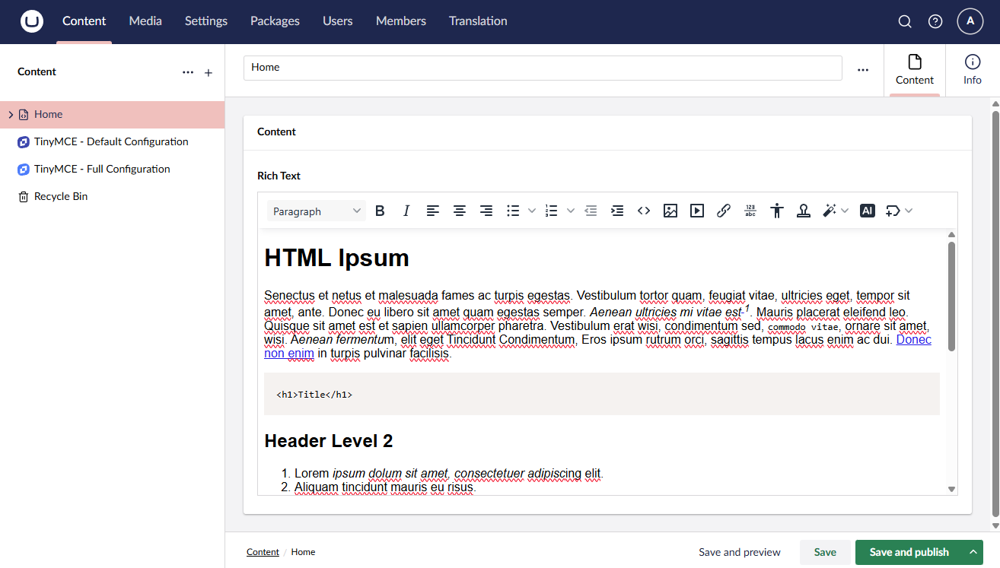
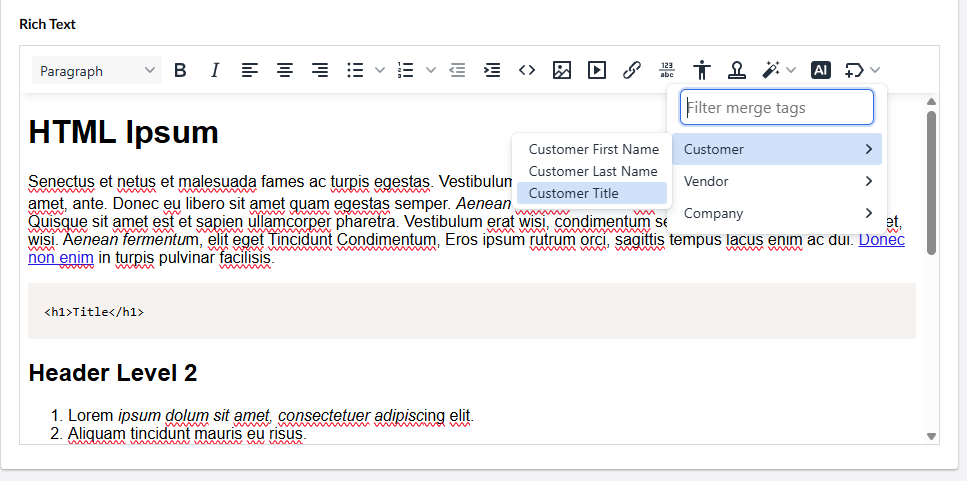
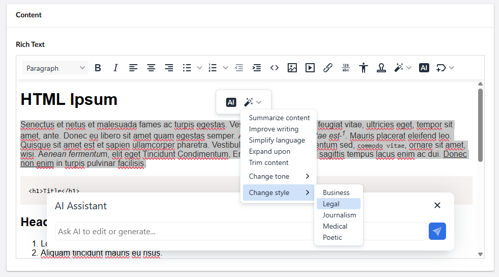

## TinyMCE for Umbraco CMS

[](https://www.nuget.org/packages/TinyMCE.Umbraco/)
[](https://www.nuget.org/packages/TinyMCE.Umbraco)
[](../LICENSE)

This package brings the [TinyMCE](https://www.tiny.cloud/) Rich Text Editor (RTE) back to [Umbraco CMS](https://umbraco.com/). It requires Umbraco 17.8.0 or later — for Umbraco 16 use the 16.x package versions, for Umbraco 18 use 18.x.

It also supports the use of TinyMCE Premium plugins with a valid subscription. Additional features include streamlined configuration for RTE Data Types in Umbraco and enhanced settings that support direct JSON-based configuration via .NET (`appsettings.json`).



If you would like to update TinyMCE to version 7 or 8, please read the "[Updating TinyMCE To Version 7 or 8](#updating-tinymce-to-version-7-or-8)" section below.

## Releases

Available via the [Releases page](https://github.com/ProWorksCorporation/TinyMCE-Umbraco/releases)


### Installation

To [install from NuGet](https://www.nuget.org/packages/TinyMCE.Umbraco), you can run the following command from the `dotnet` CLI:

    dotnet add package TinyMCE.Umbraco

In addition, you can install packages via the Visual Studio NuGet Package Manager.  This can be found in the Tools menu of Visual Studio.

> **Upgrade Umbraco to 17.8.0 first.** NuGet does not refuse this package on an older 17.x site. Instead it quietly
> lifts the few Umbraco packages this one depends on to 17.8.0 and leaves the rest of Umbraco where it was, so the
> site ends up running a mix of Umbraco versions without any warning. Upgrade `Umbraco.Cms` to 17.8.0 or later, then
> install or update this package.

### Upgrading from v15

If you are upgrading from Umbraco version 15, install this package before beginning the migration / upgrade process to version 16. Use a **16.x** version of this package for that migration — the current release requires Umbraco 17.8.0 or later.  If installed before the upgrade migration, this package will prevent the conversion to the TipTap editor and keep the TinyMCE RTE in place.

### Looking for the v13 version?

You can find the v13 version on [NuGet as TinyMCE.Umbraco.Premium](https://www.nuget.org/packages/tinymce.umbraco.premium/).  Also, the documentation is available as a Readme on the [v13/main branch here on Github](https://github.com/ProWorksCorporation/TinyMCE-Umbraco/tree/v13/main).

# Documentation

To get started with the TinyMCE Umbraco property editor and use it with your projects, you will need to add some basic configuration and need to create a new Data Type for the TinyMCE Rich Text Editor.  See the ["Usage / Setup"](#usage--setup) Section below for more information.

## Configuration

The following options are available for configuration in the `appsettings.json` or through other environment level configuration settings (`web.config`, Azure environment variables, etc).  This is using standard .NET configuration and you can learn more about [.NET Configuration here](https://learn.microsoft.com/en-us/aspnet/core/fundamentals/configuration/?view=aspnetcore-8.0).

### Umbraco CMS RichTextEditor configuration retained

The traditional Umbraco CMS TinyMCE Configuration settings continue to function as expected.  The Umbraco Documentation has a good example of the configuration options and how they can be set here: [Rich text editor settings](https://docs.umbraco.com/umbraco-cms/13.latest/reference/configuration/richtexteditorsettings).

```json
{
	"Umbraco": {
		"CMS": {
			"RichTextEditor": {
				"Commands": "RichTextEditorCommand ARRAY"
				"Plugins": ["STRING ARRAY"],
				"CloudApiKey": "STRING",
				"ValidElements": "STRING",
				"InvalidElements": "STRING",
				"CustomConfig": {JSON KEY/VALUES}
			}
		}
	}
}
```

The details on each configuration value are described below:

| Setting     | Values      |Default  | Note |
| ----------- | ----------- |---------|------|
| Commands   | RichTextEditorCommand  | None    | A list of RichTextEditorCommand objects that contain and alias (STRING), name (STRING), and mode ("Insert", "Selection", or "All"). These commands are the buttons you find at the top of the editor, such as bold, italic, and so on. |
| Plugins  | String array of TinyMCE plugins names to include  | None   | Add plugins to the list of available plugins in the TinyMCE Rich Text Editor DataType. See the [Tiny Documentation](https://www.tiny.cloud/docs/tinymce/6/plugins/) for a list of plugins. |
| CloudApiKey      | key string  | None    | The TinyMCE API Key found in [your account](https://www.tiny.cloud/my-account/integrate/#html). If applied, this will load the TinyMCE library from the Tiny Cloud URL unless the "tinyMceUrl" is specified. |
| ValidElements | string |  [See defaults](../docs/defaults.md) | Specifies the list of HTML tags available to the TinyMCE Rich Text Editor. See the [default list of ValidElements](../docs/defaults.md) for more information. If you override `ValidElements`, include `data-anchor` and `data-culture` in the `a[...]` rule, or link anchors and cultures will be stripped. |
| InvalidElements | String | None | Specifies invalid HTML tags. These tags will not be allowed. |
| CustomConfig | JSON key/value pairs | {} | Simple key/value pairs for configuration of the TinyMCE Editor and Plugins. See the [Tiny Documentation](https://www.tiny.cloud/docs/tinymce/6/plugins/) for the plugin configuration. This is here to support easy migration and upgrades. Note how these values combine with a Data Type's own settings — see [How CustomConfig combines with Data Type settings](#how-customconfig-combines-with-data-type-settings). **It is recommended to use the customConfig element below for a richer configuration experience.** | 


#### How CustomConfig combines with Data Type settings

`CustomConfig` applies to every TinyMCE editor on the site, while each Data Type also carries its own
settings. Where both set the same thing, **`CustomConfig` wins** — with one deliberate exception.

| Setting | Behaviour | How to remove something globally |
| ------- | --------- | -------------------------------- |
| `Plugins` | **Merged.** The union of the Data Type's selected plugins and the configured ones is loaded. | `pluginsToExclude` |
| Everything else, including `toolbar` | **Replaced.** The configured value overwrites the Data Type's. | The replacement itself |

So setting `"toolbar": "fullscreen"` in `CustomConfig` gives **every** editor a toolbar of exactly one
button, discarding whatever each Data Type had configured.

**Expressing a list here needs a JSON *string*, not a JSON array.** This section binds into an
`IDictionary<string, object>`, so a real array has no scalar value for the .NET configuration binder and
does not survive. Write it as an escaped string, which the package parses back into an array:

```json
"CustomConfig": {
  "plugins": "[\"fullscreen\"]"
}
```

### New Configuration Options:

This package adds addition enhanced configuration options that carry over from the v13 TinyMCE Umbraco Premium package:

```json
{
	"TinyMceConfig": {
		"tinyMceUrl": "STRING",
		"tinyMceVersion": "STRING",
		"apikey": "STRING",
		"openAiApikey": "STRING",
		"sanitizeTinyMce": true,
		"pluginsToExclude": ["STRING ARRAY"],
		"openAiApiConfig": {
			"model": "STRING",
			"developerMessage": "STRING",
			"maxCompletionTokens":  NUMBER,
			"temperature": NUMBER
		},
		"customConfig": {JSON}
	}
}
```

The details on each configuration value are described below:

| Setting     | Values      |Default  | Note |
| ----------- | ----------- |---------|------|
| tinyMceUrl  | url string  | None    | The URL location of the TinyMCE library. This allows for specific cloud URL access or self-hosted options. |
| tinyMceVersion  | string  | 6    | The version of the TinyMCE library. |
| apikey      | key string  | None    | The TinyMCE API Key found in [your account](https://www.tiny.cloud/my-account/integrate/#html). If applied, this will load the TinyMCE library from the Tiny Cloud URL unless the "tinyMceUrl" is specified. |
| openAiApikey | key string | None    | The ChatGPT API Key found in [your account](https://platform.openai.com/api-keys). This will enable a default implementation of the AI functionality using ChatGPT. The key stays on the server; see [AI provider key handling](#ai-provider-key-handling). |
| sanitizeTinyMce | boolean | true | When `true`, the editor strips any `on*` event attributes (e.g. `onclick`, `onload`) from content on load to prevent XSS. Set to `false` if you need to preserve these attributes (for example, when using `<button onclick="...">` elements in your content). |
| pluginsToExclude | String array of TinyMCE plugins names to exclude | [] | This excludes these plugins from being selected or used by the TinyMCE Rich Text Editor |
| openAiApiConfig | Configuration for the OpenAI API | SEE BELOW | This configuration allows for the selection of the OpenAI model and other API configuration. See [OpenAI documentation](https://platform.openai.com/docs/api-reference/chat/create) for more details on the settings. |
| customConfig | JSON TinyMCE Configuration | {} | See the [Tiny Documentation](https://www.tiny.cloud/docs/tinymce/6/plugins/) for the plugin configuration. **NOTE:** this is JSON and can contain nested elements unlike the key/values in the RichTextEditor configuration above. | 

The **openAiApiConfig** supported configuration properties are described below:
| Setting     | Values      |Default  | Note |
| ----------- | ----------- |---------|------|
| model  | string  | "gpt-5"    | Name of the OpenAI model to use.  See the [OpenAI Model Guide](https://platform.openai.com/docs/models) for more information on each model. |
| developerMessage  | string  | ""    | Developer-provided instructions that the model should follow, regardless of messages sent by the user. |
| maxCompletionTokens  | number  | 800    | An upper bound for the number of tokens that can be generated for a completion, including visible output tokens and reasoning tokens. |
| temperature  | number  | 1.0    | What sampling temperature to use, between 0 and 2. Higher values like 0.8 will make the output more random, while lower values like 0.2 will make it more focused and deterministic. NOTE: gpt-5 doesn't support customization of temperature. |

### Security: bundled TinyMCE 6

By default this package loads the TinyMCE **6.8.x** core it bundles (`tinyMceVersion` `6`). That core is affected by
these published advisories, which TinyMCE has fixed only in later major versions:

| Advisory | Severity | Fixed in |
| -------- | -------- | -------- |
| [GHSA-mh5m-5hw4-5c69](https://github.com/advisories/GHSA-mh5m-5hw4-5c69): XSS via a sanitization bypass through nested SVGs | High | 7.1.0 |
| [GHSA-vg35-5wq7-3x7w](https://github.com/advisories/GHSA-vg35-5wq7-3x7w): XSS via media plugin `data-mce-object` injection | High | 7.9.3 |
| [GHSA-q742-qvgc-gc2f](https://github.com/advisories/GHSA-q742-qvgc-gc2f): XSS via `data-mce-` prefixed `src`, `href` and `style` attributes | High | 7.9.3 |
| [GHSA-v98h-vmpc-fpqv](https://github.com/advisories/GHSA-v98h-vmpc-fpqv): XSS through `mce:protected` comments | High | 7.9.3 |
| [GHSA-5359-pvf2-pw78](https://github.com/advisories/GHSA-5359-pvf2-pw78): XSS in handling external SVG files through `object` or `embed` elements | Moderate | 7.0.0 |

All of them are fixed in **TinyMCE 7.9.3 or later**. To run TinyMCE 7 or 8 instead of the bundled core, register a
small `bundle` extension on your site that imports the TinyMCE 7 or 8 core (from the Tiny Cloud CDN or your own
copy), and set `TinyMceConfig:tinyMceVersion` to `7` or `8`, with `apikey` (Tiny Cloud) or `tinyMceUrl` (self-hosted)
so that plugins and skins load from the same version. Setting `tinyMceVersion` alone is not enough: the bundled 6.x
core would still run. The guides under [Updating TinyMCE To Version 7 or 8](#updating-tinymce-to-version-7-or-8) walk
through each setup.

Check the licence before you switch: TinyMCE 6 is MIT licensed, while TinyMCE 7 and later are available under GPLv2+
(self-hosted, with `license_key: "gpl"`) or a commercial licence from Tiny, and Tiny Cloud needs an account with Tiny.

TinyMCE 6.x remains the default in this release by maintainer decision, so that upgrading the package doesn't change
an existing site's licence terms. The editor is only available to signed-in backoffice users.

### AI provider key handling

**The OpenAI key stays on the server.** The AI assistant sends each request to this package's own back-office endpoint
(`POST /umbraco/management/api/v1/tiny-mce/ai/completion`), and the web server calls OpenAI with the key. The key and
the `openAiApiConfig` settings are never sent to the browser. Only signed-in back-office users can use the endpoint.

What this means for site owners:

* **Outbound network access.** Requests now go from the web server to OpenAI, not from editors' browsers. If the
  server's outbound traffic is restricted, allow `api.openai.com`.
* **Set a spend cap.** The endpoint applies no usage limit of its own, so set a monthly budget or spend limit for the
  key in your OpenAI account. A dedicated key for Umbraco makes this easier.
* **Usage is logged.** Each request writes one log entry with the back-office user and the outcome, under the
  `TinyMCE.Umbraco` log category. Successes are logged at `Information`, failures at `Warning` with a reason such as
  `rate-limited` or `authentication`. The prompt, the generated text and the key are never logged. Your site's own
  logging configuration decides what is kept: a site whose minimum level is `Warning` keeps only the failures. If you
  want usage attribution on such a site, you can lower the level for this category alone, for example:

  ```json
  {
    "Serilog": {
      "MinimumLevel": {
        "Override": {
          "TinyMCE.Umbraco": "Information"
        }
      }
    }
  }
  ```

* **Errors editors see.** If the key is missing or OpenAI refuses a request, editors get a short message telling them
  what to do (for example, to try again later, or to ask an administrator to check the key). OpenAI's own error text
  is never shown, because it can include part of the key.

A future release may let AI connections be provided by [Umbraco.AI](https://github.com/umbraco/Umbraco.AI) instead;
the endpoint is designed so that can happen without changes for editors.

### Credentials

Each credential setting is one of two kinds:

| Setting | Kind | Where it goes |
|---|---|---|
| `TinyMceConfig:openAiApikey` | **Provider secret** | Kept on the server only. Used by the server to call OpenAI. |
| `TinyMceConfig:apikey` | **Public client identifier** | Sent to signed-in back-office users only, because TinyMCE's CDN needs it in the browser. Protect it with the approved-domain list in your [Tiny Cloud dashboard](https://www.tiny.cloud/my-account/domains/). |
| `Umbraco:CMS:RichTextEditor:CloudApiKey` | **Public client identifier** | As `TinyMceConfig:apikey`. |

## Data Types

### Rich Text Editor

#### Open Source Plugins

The following open source TinyMCE plugins are available to add to the TinyMCE Umbraco RTE editor tools via the DataType configuration:

* Accordion (accordion)
* Code Sample (codesample)
* Emoticons (emoticons)
* Fullscreen (fullscreen)
* Help for Editors (help)
* Insert Date/Time (insertdatetime)
* Search and Replace (searchreplace)
* Word Count (wordcount)

#### Premium Plugins

If the `appsettings.json` configuration has a valid Tiny apiKey set in configuration, then the following additional packages are available to the TinyMCe Umbraco Rich Text Editor:

* Accessibility Checker (a11ychecker)
* Advanced Typography (typography)
* Case Change (casechange)
* Checklist (checklist)
* Export (export)
* Footnotes (footnotes)
* Format Painter (formatpainter)
* Merge Tags (mergetags)
* Page Embed (pageembed)
* Permanent Pen (permanentpen)
* Spell Checker Pro (tinymcespellchecker)
* Table of Contents (tableofcontents)

Most of these have a Command / Toolbar associated with them and are disabled by default.  To enable them, go to the Data Type in the Settings section of Umbraco to edit the toolbars available.



#### Additional Premium Plugins

This package can be used to access some of the additional TinyMCE packages that may require more configuration to be used effectively.  

In addition to the packages listed above, below are the additions TinyMCE Packages that are available via the TinyMCE Rich Text Editor:

* Advanced Code Editor (advcode)
* Advanced Table Editor (advtable)
* Advanced Templates (advtemplate)
* AI Assistant Shortcuts (ai)
* Enhanced Media Embed (mediaembed)
* Link Checker (linkchecker)
* PowerPaste (powerpaste)
* Spelling Autocorrect (autocorrect)



### Usage / Setup
In order to use the TinyMCE Rich Text Editor, you will need to create at least one Umbraco Data Type that uses this property editor.  Learn more about Umbraco Data Types and how to create them in the [Umbraco Documentation here](https://docs.umbraco.com/umbraco-cms/fundamentals/data/data-types).

#### Additional Features

The TinyMCE Rich Text property editor adds a few new configuration options (from the v15 Umbraco TinyMCE Property Editor) for each Data Type that you create:

1. Plugin Selection: Similar to the Toolbar items, you can select which plugins are enabled / available for this Data Type via the back-office UI.
2. CustomConfig: Each Data Type that implements this editor has its own TinyMCE Configuration JSON that can be used for a custom configuration specific to this Data Type.
3. Mode: Choose between **Classic** (the default) and **Inline**. Classic renders the editor with its own toolbar and border, editing content inside an iframe. Inline turns the content area itself into the editable region, with the toolbar appearing on focus (see the caveats below before enabling it).

These Data Type configuration options are managed via the Data Type editing interface in the back-office of Umbraco.

##### Where picked stylesheets are loaded from

The **Stylesheets** setting stores each sheet relative to Umbraco's CSS root, and the editor resolves it
against `Global:UmbracoCssPath` (default `/css`) — the same way Umbraco's own rich text editor does. A
value that is already rooted at that path, or an absolute `http(s)` URL, is used as-is rather than being
prefixed again. If you are upgrading from a version that stored the full path and previously saw
stylesheet requests 404 at `/css/css/...`, that is fixed.

Note that stylesheets are only loaded into the editing surface in **Classic** mode; see the inline mode
caveats below.

##### Culture-specific document links

A document link that carries a culture (`data-culture`, for example in content created elsewhere) keeps it: it
reopens in the link picker on that language version, resolves to that language's URL on the website, and loses the
culture when the link is changed to media or an external URL. The link picker doesn't offer a culture choice in a
rich text editor, though: in Umbraco 17.8 only the Multi URL Picker does, and Umbraco's own rich text editor behaves
the same way.

##### Inline mode caveats

> **Inline mode is verified in Chromium-based browsers (Chrome, Edge, Brave, Opera) and in Firefox.**

Inline mode also behaves differently from classic mode in two ways that are inherent to TinyMCE rather than to this package:

* The **Dimensions** setting is ignored — there is no editor chrome to size. The editable region is styled by the package instead, and grows with its content.
* The stylesheets picked under **Stylesheets** still populate the style *formats* dropdown, but they are not loaded into the editing surface, because there is no iframe document to load them into. Content in an inline editor is styled by the back-office, so it will not preview your site's CSS.

## Extending the Rich Text Editor

If you would like to extend the TinyMCE for Umbraco CMS package, there is an [npm package](https://www.npmjs.com/package/@tiny-mce-umbraco/backoffice) avaliable to allow extentions and customization.  It can be installed for development by running this on the command line:

    npm install --save-dev @tiny-mce-umbraco/backoffice

> **Requirements for extension projects:** this package declares `@umbraco-cms/backoffice` `^17.8.0` as a **peer dependency**, so your project needs a matching backoffice version installed alongside it — building against an older backoffice will produce a peer dependency conflict. Building also requires Node.js 24.13+ and npm 11+.

Creating an extension to this package aligns with how [Umbraco CMS allowed custom packages in version 15](https://docs.umbraco.com/umbraco-cms/fundamentals/backoffice/property-editors/built-in-umbraco-property-editors/rich-text-editor-tinymce/plugins).  

The main difference is that the imports need to be from the @tiny-mce-umbraco/backoffice package reference like so:

	import { UmbTinyMcePluginBase } from '@tiny-mce-umbraco/backoffice/core';
	import type { TinyMcePluginArguments } from '@tiny-mce-umbraco/backoffice/core';
	import type { Editor } from '@tiny-mce-umbraco/backoffice/external/tinymce';

### Plugin Class

Create a TypeScript file that exports a default class extending `UmbTinyMcePluginBase`:

```typescript
import { UmbTinyMcePluginBase } from '@tiny-mce-umbraco/backoffice/core';
import type { TinyMcePluginArguments } from '@tiny-mce-umbraco/backoffice/core';
import type { Editor } from '@tiny-mce-umbraco/backoffice/external/tinymce';

export default class MyCustomPlugin extends UmbTinyMcePluginBase {
    readonly #editor: Editor;

    constructor(args: TinyMcePluginArguments) {
        super(args);
        this.#editor = args.editor;
    }

    // Called before the editor initializes — use this to modify the TinyMCE config
    static override async extendEditorConfig(config: Record<string, unknown>): Promise<void> {
        config.myPlugin_option = 'value';
    }

    // Called after the editor has been created
    override async init(): Promise<void> {
        this.#editor.ui.registry.addButton('myButton', {
            text: 'My Button',
            onAction: () => this.#editor.insertContent('<p>Hello!</p>'),
        });
    }
}
```

The built JS file must use **default export**. Umbraco loads the default export as the plugin class.

### Accessing the TinyMCE Global

Inside a plugin class you already have the editor (`args.editor`), so you rarely need the TinyMCE global
itself. When you do — to read the icon set, a utility, or `tinymce.Env` — import it from
`@tiny-mce-umbraco/backoffice/external/tinymce`:

```typescript
import { tinymce, loadTinyMce } from '@tiny-mce-umbraco/backoffice/external/tinymce';
```

> **Do not read properties off `tinymce` at module scope.** As of 17.6.3 the TinyMCE core is loaded on
> demand rather than up front, so it may not exist yet when your module is first evaluated. The `tinymce`
> export is a live view of `window.tinymce`, so reading it from anywhere the package calls into your
> plugin is safe — `extendEditorConfig`, the constructor and `init()` all run with a core present. It is
> only code at the top level of your module that can run too early.

```typescript
// Wrong — runs when the module loads, possibly before any core exists
const iconSet = tinymce.IconManager.get('default');

// Right — inside any of the plugin hooks
static override async extendEditorConfig(config: Record<string, unknown>): Promise<void> {
    config.myPlugin_icons = tinymce.IconManager.get('default');
}

override async init(): Promise<void> {
    const iconSet = tinymce.IconManager.get('default');
}

// Also right — from your own code, outside a plugin hook
const iconSet = (await loadTinyMce()).IconManager.get('default');
```

`loadTinyMce()` resolves to the TinyMCE global, loading the core this package ships with only if nothing
else has already provided one — so on a site hosting its own TinyMCE it returns that core rather than
downloading a second one.

### Umbraco Package Manifest

Create an `umbraco-package.json` in your plugin's `App_Plugins` folder:

```json
{
  "$schema": "../../umbraco-package-schema.json",
  "id": "My.TinyMCE.Plugin",
  "name": "My TinyMCE Plugin",
  "version": "1.0.0",
  "extensions": [
    {
      "type": "tinyMcePlugin",
      "alias": "my.tinymce.plugin",
      "name": "My TinyMCE Plugin",
      "js": "/App_Plugins/my-tinymce-plugin/my-plugin.js",
      "meta": {
        "config": {
          "plugins": ["myTinyMcePluginName"]
        }
      }
    }
  ]
}
```

The `meta.config` object is merged into the TinyMCE initialisation config for every editor instance. Use `meta.config.plugins` to load a TinyMCE plugin by name (e.g. a premium plugin like `"mentions"`). If `meta.config` is not needed, it can be omitted.

> **Note:** `umbraco-package.json` is the correct manifest format for Umbraco v16+. The older `package.manifest` file format is not used for `tinyMcePlugin` extensions.

### Vite Configuration

**Important:** You must mark `@tiny-mce-umbraco` as external in your Vite build configuration alongside `@umbraco`. Without this, the package gets bundled into your extension a second time, causing a duplicate custom element registration error in the browser console (`"Failed to execute 'define' on 'CustomElementRegistry': the name 'umb-stylesheet-rule-input' has already been used with this registry"`).

```typescript
// vite.config.ts
export default defineConfig({
  build: {
    rollupOptions: {
      external: [/^@umbraco/, /^@tiny-mce-umbraco/],
    },
  },
});
```

### Working Example

A complete working plugin using this pattern — a TinyMCE Mentions configuration — is in [`examples/tinymce-mentions-plugin/`](../examples/tinymce-mentions-plugin/), with its TypeScript source, `package.json`, `tsconfig.json` and Vite configuration. It builds into the [test site](../src/TinyMCE.Umbraco.TestSite/wwwroot/App_Plugins/tinymce-mentions-plugin/), where its `umbraco-package.json` registers it.

## Updating TinyMCE To Version 7 or 8

The TinyMCE.Umbraco package allows for changing out the TinyMCE that is loaded by the package to a newer open source version, newer TinyMCE Cloud version, or a licensed on-premise installation.

For more information read the guides appropriate to your situation:

 - [Install Open Source GPLv2+ versions of TinyMCE](/docs/README_opensource_onpremise.md)
 - [Install Licensed on-premise versions of TinyMCE](/docs/README_onpremises.md)
 - [Reference Cloud CDN versions of TinyMCE](/docs/README_cloud_cdn.md)


# Support and More

If you have questions about TinyMCE plugins, please contact TinyMCE Support directly.

If something specific to the Property Editors in this package or the Configuration isn't working as you would expect, please submit a question via the [GitHub Issues](https://github.com/ProWorksCorporation/TinyMCE-Umbraco/issues) for this project.  We will do our best to monitor and respond, but please be patient with us.

In addition, you may find that the community is very helpful and you can ask questions of them on the [Umbraco Forums](https://forum.umbraco.com/) or the [Umbraco Discord Server](https://community.umbraco.com/get-involved/community-discord-server/).


## Contributing

Contributions to this package are most welcome! Please read the [contributing guidelines](CONTRIBUTING.md).


## License

Copyright &copy; [ProWorks Corporation](https://proworks.com).

All source code is licensed under the [MIT License](../LICENSE).

The initial source code has been derived from [Umbraco CMS](https://github.com/umbraco/Umbraco-CMS), originally licensed under the MIT License.


## Acknowledgments

Thanks to [TinyMCE](https://www.tiny.cloud/) and [Umbraco](https://umbraco.com/) for their support during the package development.

Special thanks to [Lee Kelleher](https://github.com/leekelleher) and [Jacob Overgaard](https://github.com/iOvergaard) for their contributions, help getting started, and for giving valuable feedback along the way.

Also thanks to the [ProWorks](https://www.proworks.com) team for their encouragement, support, and contributions.
